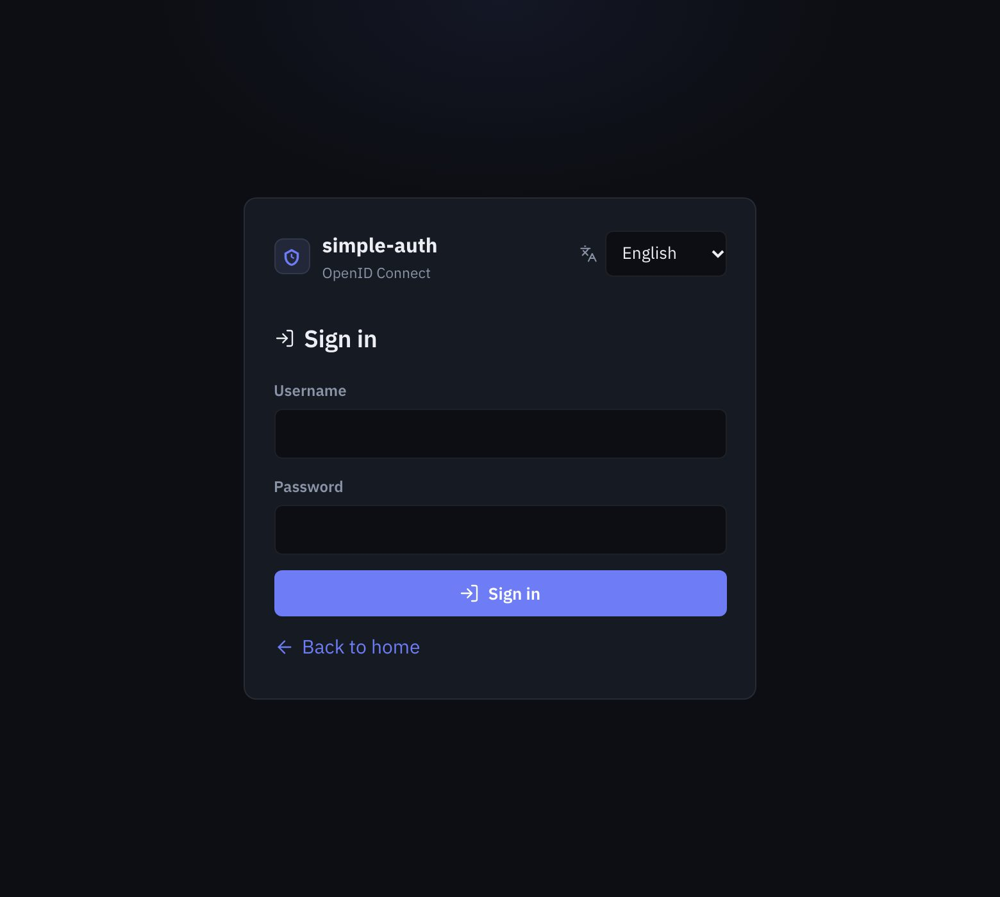
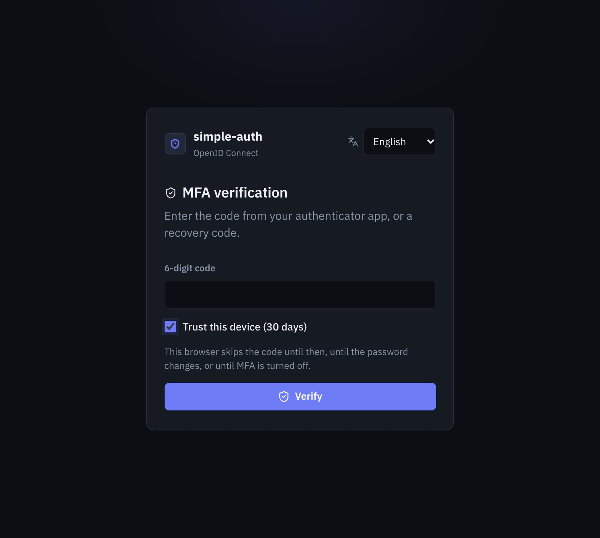
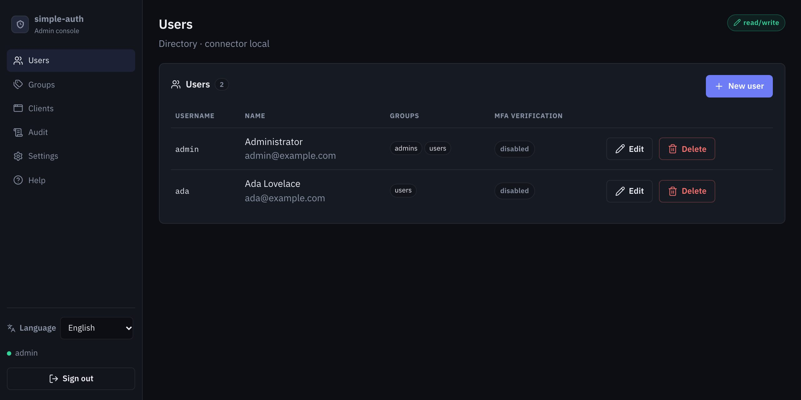
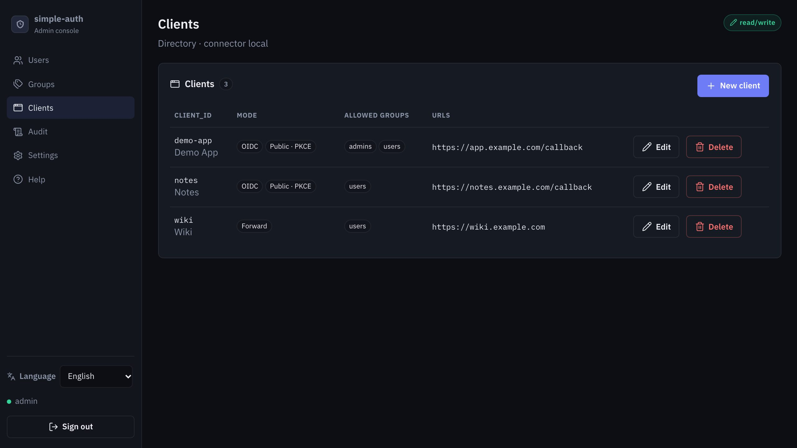
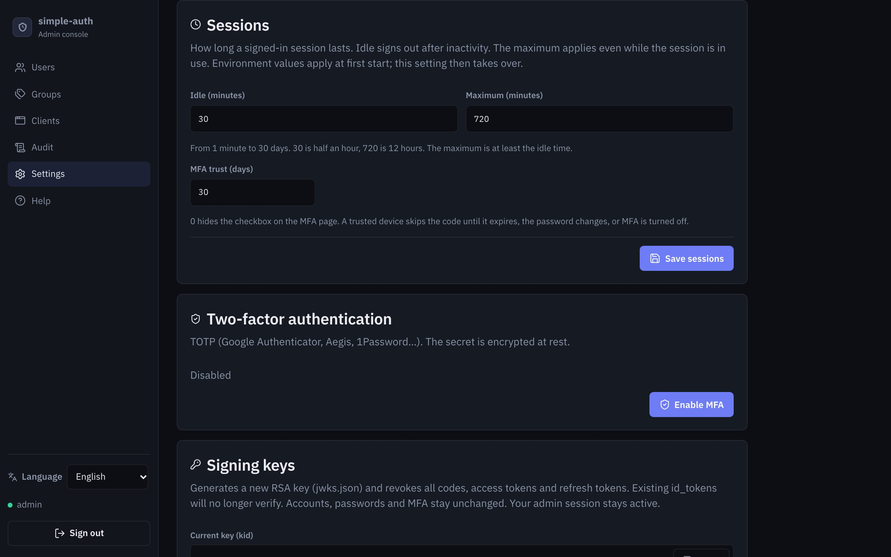

# simple-auth

Identity directory: **OpenID Connect** for apps that implement it, **session check** for the others.  
**FastAPI + Authlib** backend, **Vite + React** console.

## Screens

Sign-in, MFA, and the console. The title on the sign-in screen is the one set in **Console → Settings**.

| Sign-in | MFA |
| --- | --- |
|  |  |







## Run (Docker)

```bash
docker compose up --build
```

`./data` is mounted into the container. Set `PUID` and `PGID` to the host directory owner (`id -u` and `id -g`) so the process can write it. The default is `1000:1000`. The image itself still starts as uid `10001` when you run it without Compose.

- App: http://localhost:8000  
- Console: http://localhost:8000/admin  
- Discovery: http://localhost:8000/.well-known/openid-configuration  

Seed account (local connector): `admin` (`admins` group). With an HTTP issuer its password is `admin`. With an HTTPS issuer it is random and printed once in the container log on first start (`docker compose logs auth`), unless `OIDC_ADMIN_PASSWORD` is set.  
Change the password on first sign-in (min. 12 characters, letters and digits).

In production: HTTPS (`OIDC_ISSUER=https://…`). Cookie `Secure`, admin MFA, and the HTTP ban follow the issuer: an HTTPS issuer answers every route but `/api/health` with `400 insecure_transport` unless the request is HTTPS end to end or comes from a trusted proxy with `X-Forwarded-Proto: https`. Set `OIDC_ALLOWED_HOSTS=auth.example.com` and `OIDC_TRUSTED_PROXIES` to the reverse proxy address (required, or every request is refused) so audit logs keep the client IP and the backend can read `X-Forwarded-*`. Set `OIDC_SECRET_KEY` (kept outside `data/`) so TOTP secrets are not encrypted with a key stored next to them. The PKCE demo is off by default on an HTTPS issuer.  
Caddy example: [deploy/Caddyfile](deploy/Caddyfile).

The sign-in screen title is the name set in **Console → Settings**, or the issuer host and port when that name is empty (`localhost:8000`). An optional tagline sits under it.

TOTP MFA is enrolled on the profile page, and required for admins when the issuer is HTTPS. The authenticator entry uses that same name and the username. It also applies to LDAP accounts (secret encrypted in JSON). An admin can reset a user’s MFA.

## Releases

A `vX.Y.Z` tag (e.g. `v1.0.0`) runs CI: tests, Docker image, then a GitHub Release.

- **Archives**: `simple-auth-X.Y.Z.zip` and `.tar.gz` + `SHA256SUMS` (source, no `data/`, no secrets)
- **Image**: `ghcr.io/<org>/<repo>:X.Y.Z` (linux/amd64 + linux/arm64). `latest` is pushed from the default branch.

```bash
docker pull ghcr.io/<org>/<repo>:1.0.0
OIDC_IMAGE=ghcr.io/<org>/<repo>:1.0.0 docker compose up
```

Locally, without a GitHub tag: `bash scripts/package.sh 0.0.0-dev` writes archives to `dist-release/`.

CI image on GHCR: `ghcr.io/<org>/<repo>:latest`.

## Reverse proxy

Apps without OIDC: Caddy `forward_auth` / nginx `auth_request` call `GET /session/check` on the local backend. The protected URL comes from `X-Forwarded-Proto` / `X-Forwarded-Host` / `X-Forwarded-Uri`, read only from `OIDC_TRUSTED_PROXIES`. Signed in and allowed: `200` and `Remote-User` / `Remote-Email` / `Remote-Name` / `Remote-Groups`. Not signed in: `401` and `Location` to `/login`. Wrong groups, or a URL that no Forward client owns: `403`.

`OIDC_TRUSTED_PROXIES` is a comma-separated list of IPs or CIDRs: the address the backend sees the proxy connect from. Proxy on the same host as uvicorn: `127.0.0.1`. Backend in Docker with the port published: the Docker bridge gateway, e.g. `172.17.0.0/16` (or the subnet of the Compose network if the proxy is a container on it). Run uvicorn with `--no-proxy-headers` (the image does): otherwise uvicorn swaps the proxy address for the client's before the app can check it.

Do not build `?rd=` from the raw request URI (`$request_uri`, `{uri}`): it is not encoded, so a client can append its own `rd`. Without trusted forwarded headers only the first `rd` is read.

After login the browser goes through `/session/start` on the app host, then `/session/handoff` on auth, then `/session/establish` on the app host (`/session/*` is proxied to auth), so the session cookie is set for that host. It has no `Domain` attribute: it belongs to `app.example.com` only, never to `*.example.com`, so another app or a compromised subdomain cannot read or replay it. The proxy keeps the app's `Host`: simple-auth accepts a Forward client's host on `/session/*` only, and any other route on that host gets `400 Invalid host header`. `/session/start` sets a short-lived state cookie (`__Host-sa_gate` over HTTPS) and the one-time ticket is bound to it: a ticket opened in another browser does not sign it in. The app must only be reachable through the proxy, or anyone can send it a `Remote-User` header. That cookie only answers `/session/check` for its own origin: the app's upstream receives it, so it never opens the console or another app. In Admin → Clients, a client is either **OIDC** (redirect URIs) or **Forward** (session-check URLs + groups). `OIDC_APP_ORIGINS` seeds a Forward client on first boot.

[deploy/Caddyfile](deploy/Caddyfile) · [deploy/nginx.conf](deploy/nginx.conf)

```caddy
auth.example.com {
	encode gzip
	reverse_proxy 127.0.0.1:8000
}

app.example.com {
	handle /session/* {
		reverse_proxy 127.0.0.1:8000
	}
	handle {
		forward_auth 127.0.0.1:8000 {
			uri /session/check
			copy_headers Remote-User Remote-Email Remote-Name Remote-Groups
		}
		reverse_proxy 127.0.0.1:3000
	}
}
```

## Run (local dev)

```bash
# Backend
python3.12 -m venv .venv
source .venv/bin/activate
pip install -r backend/requirements.txt
export PYTHONPATH=backend
export OIDC_FRONTEND_ORIGIN=http://localhost:5173
uvicorn app.main:app --reload --host 127.0.0.1 --port 8000 --no-proxy-headers

# Frontend (other terminal)
cd frontend
npm install
npm run dev
```

- Console: http://localhost:5173/admin  
- PKCE demo: http://localhost:5173/demo

## Identity connectors

**Users / groups** go through a connector. **OIDC clients** and settings always stay in local JSON.

| Connector | Variable | Writable |
|---|---|---|
| `local` (default) | `OIDC_CONNECTOR=local` | yes (JSON) |
| `ldap` | `OIDC_CONNECTOR=ldap` | no (read + bind) |

### Local

Users and groups in `data/identities.json`.  
OIDC clients in `data/clients.json`.  
Settings, consents, and the MFA overlay in `data/directory.json`.

### LDAP

```bash
export OIDC_CONNECTOR=ldap
export LDAP_URL=ldaps://localhost:636
# cleartext ldap:// is refused unless LDAP_ALLOW_INSECURE=1 (dev only)
# or LDAP_STARTTLS=1 on ldap://
export LDAP_BIND_DN='cn=admin,dc=example,dc=com'
export LDAP_BIND_PASSWORD=secret
export LDAP_USER_BASE='ou=people,dc=example,dc=com'
export LDAP_USER_FILTER='(uid={username})'
export LDAP_GROUP_BASE='ou=groups,dc=example,dc=com'
export LDAP_GROUP_FILTER='(objectClass=groupOfNames)'
export LDAP_ADMIN_GROUP=admins
# optional: limit groups exposed in the groups claim
# export LDAP_GROUP_ALLOWLIST=admins,users
# optional: CA bundle for a private PKI (the server certificate is always verified)
# export LDAP_CA_FILE=/etc/ssl/ldap-ca.pem
# optional: filter an enabled account must match; disabled accounts lose sessions and tokens
# export LDAP_USER_ENABLED_FILTER='(!(userAccountControl:1.2.840.113556.1.4.803:=2))'
```

Users authenticate with an LDAP bind, throttled like local accounts. The LDAP server certificate and host name are verified (`ldaps://` and StartTLS). **Groups are fetched automatically**: every group under `LDAP_GROUP_BASE` matching `LDAP_GROUP_FILTER` whose `member` attribute contains the user DN. No checkbox in the console.

Required choice: `LDAP_ADMIN_GROUP` (group that opens the console).  
Optional: `LDAP_GROUP_ALLOWLIST` so the `groups` claim does not expose the whole LDAP tree.

## Local data

Created on first start under `data/`:

- `identities.json` — users and groups (local connector only)
- `clients.json` — OIDC clients (secrets hashed)
- `directory.json` — settings, consents, MFA overlay
- `runtime.sqlite` — codes, tokens and interactions (hashed)
- `jwks.json` — RS256 signing key
- `audit.jsonl` — audit log (sign-in, MFA, admin)

Files in `data/` are `0600`, the directory is `0700`.

## Hardening

- PKCE S256 required, Authorization Code only, RS256 only
- Redirect URIs are absolute `http(s)` URLs with no fragment; an HTTPS issuer accepts only `https`
- `prompt=login` and `max_age` force a new sign-in; `prompt=none` returns an OAuth error
- Sessions regenerated after login/MFA. Idle and absolute limits are set in Admin → Settings (defaults 30 min idle, 12 h absolute, from `OIDC_SESSION_IDLE` and `OIDC_SESSION_ABSOLUTE` at first start). Sign-out revokes the cookie server-side
- MFA can offer “trust this device” for a number of days (`OIDC_MFA_TRUST_DAYS`, default 30; 0 hides it). The browser cookie is HttpOnly; a password change, MFA disable, or expiry asks for the code again
- `GET /oauth/logout` without a matching `id_token_hint` asks for confirmation
- `/oauth/revoke` authenticates the client and only revokes that client's tokens
- Password change, disable, delete, and MFA reset/disable revoke sessions and refresh tokens
- Authorization codes and refresh tokens are one-time; reuse revokes the token family
- Headers (CSP, HSTS on HTTPS, X-Frame-Options, nosniff)
- `Remote-*` values cannot inject extra groups or header lines
- CSRF: `Origin` check on `/api` mutations, `SameSite=lax` session cookie
- CORS limited to the issuer and frontend
- bcrypt passwords (12 rounds, rejected above 72 bytes), checked outside the store lock
- Sign-in throttle (atomic, 10 min window): 8 attempts per client IP and account, `OIDC_LOGIN_ACCOUNT_LIMIT` (default 50) per account from all addresses, so one source cannot lock an account out
- TOTP secrets encrypted (Fernet, `OIDC_SECRET_KEY` when set), HMAC recovery codes, 5 MFA attempts per account per window; a TOTP step or recovery code is accepted once, even under concurrent requests
- `email_verified` is true only when an admin marks the address verified
- 15 min access tokens; refresh rotation + family revoke on reuse
- SQLite (WAL) for codes, tokens, tickets and the per-address login limiter, so several processes on one host share one data directory
- JSON file lock for identities, clients and settings
- `X-Forwarded-For` is trusted only from `OIDC_TRUSTED_PROXIES`
- Container: non-root user, `cap_drop: ALL`, `no-new-privileges`, `read_only`

## Integrate an application

1. Create an OIDC client in the console. The secret is shown once; the app sends it with the code to `/oauth/token`. The in-console help explains the exchange.
2. Point the issuer to `http://localhost:8000`
3. Useful scopes: `openid profile email groups offline_access`

The `groups` claim lists the user’s group names.

Apps without OIDC: gate them with `GET /session/check` ([reverse proxy](#reverse-proxy)).

The console UI is translated (en, de, fr, es, it, pt) from the browser language.

## License

MIT — see [LICENSE](LICENSE).
